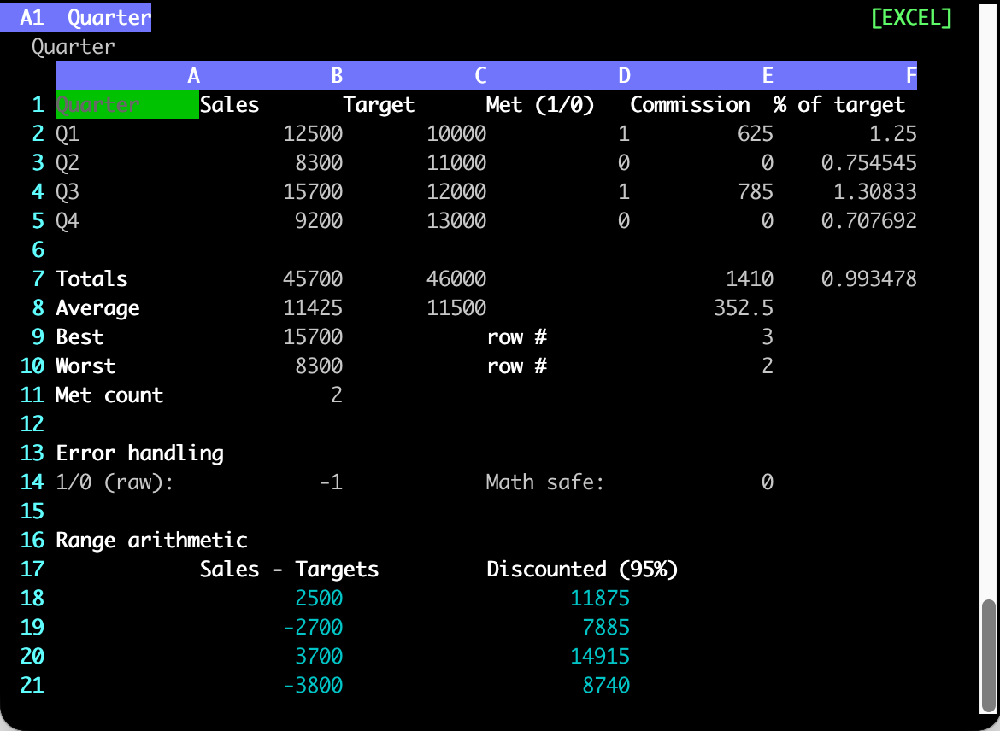
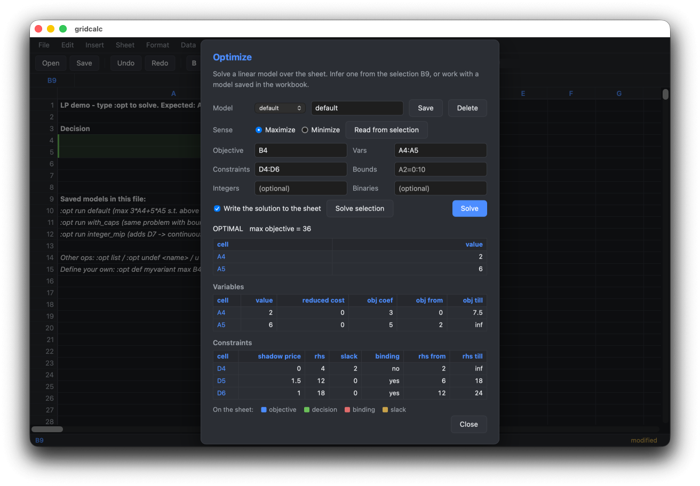

# gridcalc

[](https://pypi.org/project/gridcalc/) [](https://pypi.org/project/gridcalc/) [](LICENSE)

A programmable spreadsheet for developers and technical users, with Excel-compatible formulas, Python escape hatches, XLSX interop, goal seek, and LP/MIP solving. It ships **two frontends over one engine**: a curses terminal app, and a desktop window that renders the same workbook in a webview. The same engine also **runs `.xlsx` models headlessly**: inputs and outputs go by defined name, with no Excel and no window.

Inspired by Serge Zaitsev's [kalk](https://github.com/zserge/kalk).



*The terminal app over `example_excel.json`.*



*The desktop app solving `example_lp.json` -- the solution is written to the sheet behind the dialog.*

```sh
pip install gridcalc
gridcalc budget.json        # terminal
gridcalc-web budget.json    # desktop window  (needs the [web] extra)
```

**Documentation: <https://shakfu.github.io/gridcalc/>** -- install, tour, formula reference, optimization guide, file format, Python API, and the design notes.

---

## Run an Excel workbook as a function

Give a `.xlsx` model its inputs by defined name, recalculate, and read its outputs by name. Excel is not needed, and nothing opens a window. [`examples/example_loan.xlsx`](examples/example_loan.xlsx) is a loan model with inputs `Rate`, `Years` and `Principal`, and outputs `Payment`, `TotalPaid` and `Schedule` (a spill of year and remaining balance):

```sh
gridcalc examples/example_loan.xlsx --set Rate=0.04 --set Years=15 --get Payment
```

```json
{
  "inputs":  {"Rate": 0.04, "Years": 15},
  "outputs": {"Payment": -2219.06},
  "errors":  []
}
```

Run many cases against one load, from a JSON list of inputs:

```sh
echo '[{"Rate": 0.03}, {"Rate": 0.06, "Years": 20}]' > cases.json
gridcalc examples/example_loan.xlsx --inputs cases.json --get Payment --get Schedule#
```

Or from Python:

```python
from gridcalc.book import Book

book = Book.open("examples/example_loan.xlsx")
book.run({"Rate": 0.04, "Years": 15}, ["Payment"])        # {'Payment': -2219.06}
book.run_many([{"Rate": r / 100} for r in range(1, 10)], ["Payment"])
```

- **Targets** are the workbook's defined names, sheet-local names (`Inputs!Rate`), or cells and ranges (`Out!B2:D9`). `Name#` reads the whole array a formula spills.

- **Values** are JSON: numbers, booleans, `null`, text, and lists of rows for a range. Text input is never read as a formula.

- **Each case starts from the workbook as loaded.** A batch writes only the cells that change between cases, so a case costs one incremental recalculation. On a 20,000-formula sheet that is about 110 ms.

- **Exit codes:** `0` means the run worked. `2` means an output you named holds an error, such as `#REF!`. `1` means bad input, such as an unknown name or a value of the wrong shape; it is reported before anything is written.

- **Safe by default.** A workbook's Python (code blocks, PYTHON-mode cells) runs only with `--trust`. Excel formulas are capped at Excel's length and nesting limits, and a recalculation stops after 30 s.

- **`--convert out.xlsx`** saves the workbook with the inputs written in.

**How close to Excel?** On 279 workbooks that Excel saved, with 79,598 formula cells, gridcalc's result matches Excel's saved value in 99.0% of cells. The workbooks are IronCalc's and pycel's function test suites. They exercise functions at their edges, and gridcalc was fixed against them, so read 99.0% as an upper bound for files it has not seen. What still differs is listed in [`TODO.md`](TODO.md) and [`docs/dev/excel-corpus.md`](docs/dev/excel-corpus.md). Not supported: `.xls`, VBA macros, pivot-table refresh, and external data connections.

Full reference: <https://shakfu.github.io/gridcalc/reference/cli/#named-inputs-and-outputs>

---

## What it gives you

- **Excel-compatible formulas** (`=IF(A1>=B1, A1*0.05, 0)`) and arrays (`=SUM(A1:A10 * B1:B10)`) without leaving the terminal.

- **Multi-sheet workbooks** with cross-sheet refs (`=Sheet2!A1`) and a proper dep graph.

- **Three formula modes** per file: strict Excel, Excel-plus-`py.*`, or full Python `eval` with numpy/pandas.

- **Headless `.xlsx` runs** -- `--set`/`--get` by defined name, batches from JSON, a Python `Book` API ([above](#run-an-excel-workbook-as-a-function)).

- **xlsx interop** via OpenXLSX C++ -- read every sheet's formulas + values; export with cached values.

- **Linear, mixed-integer & quadratic programming** built in via HiGHS -- `:opt max B4 vars A4:A5 st D4:D6` solves from cells in the sheet, with shadow prices, infeasibility diagnosis, and RHS sweeps. Models persist in the workbook.

- **Goal-seek** -- `:goal B10 = 100 by A1` adjusts a variable so a formula hits a target value.

- **Vim-style command line** (`:w`, `:e`, `:q`, `/search`, `y/p`, visual selection, undo), with **system-clipboard copy/paste** -- yank pushes values as TSV, paste pulls TSV in from other apps.

- **A desktop app as well as a terminal one** -- the same engine behind a mouse-driven grid with menus, a Ctrl-K command palette, and solver results painted onto the sheet. Most `:` commands are a [shared registry](src/gridcalc/commands.py) both frontends dispatch, so they behave identically in each.

## Install

```sh
pip install gridcalc            # core: zero third-party runtime deps
pip install 'gridcalc[extras]'  # adds numpy, pandas, pygments
pip install 'gridcalc[web]'     # adds the desktop window (gridcalc-web)
```

Or with [uv](https://docs.astral.sh/uv/): `uv tool install 'gridcalc[extras]'`.

The **core** install has **zero third-party runtime dependencies on Linux and macOS** -- the full Excel function library (465 functions: statistical distributions, financial functions, `LINEST`/`TREND` regression, ...) works on stdlib alone. Details in the [install guide](https://shakfu.github.io/gridcalc/install/).

## A taste

Cells hold a number, a label (any non-`=`-prefixed string), or a formula (prefixed with `=`):

```text
        A          B          C
1  Revenue   Cost       Margin
2  1000      600        =(A2-B2)/A2*100      <- formula
3  1200      700        =(A3-B3)/A3*100
4  Total     =SUM(B2:B3) =AVG(C2:C3)
```

Press `:` for the command line -- `:w` saves, `:o` opens, `:q` quits, `v` selects, `u` undoes, `/` searches. The [quick tour](https://shakfu.github.io/gridcalc/tour/) covers the rest, and the [command reference](https://shakfu.github.io/gridcalc/reference/commands/) lists every command.

Try the shipped examples:

```sh
gridcalc example_excel.json          # sales report, named ranges, IF/MATCH
gridcalc example_excel.xlsx          # the same workbook saved as xlsx
gridcalc example_hybrid.json         # progressive tax via py.* + aggregations
gridcalc example.json                # PYTHON: numpy/pandas, list-comprehensions
gridcalc example_multisheet.json     # 3-sheet budget, cross-sheet formulas
gridcalc example_lp.json             # LP/MIP demo -- type :opt to solve
gridcalc example_goal.json           # goal-seek demo -- :goal B1 = 11 by A1
gridcalc example_loan.xlsx           # loan model -- run it headless with --set/--get
```

## Scripting it

Any operation flag turns the same command line into a batch run that never opens a window -- so the solver is reachable from cron, a Makefile, or CI:

```sh
gridcalc plan.json --solve                       # run the workbook's saved model
gridcalc plan.json --solve --sens                # ... with shadow prices
gridcalc plan.json --sweep 'D5 6:24 9'           # parametric right-hand side
gridcalc book.json --goal 'B10 = 100 by A1'      # goal seek
gridcalc book.json --eval '=SUM(A1:A10)'         # evaluate a formula
gridcalc book.xlsx --set Rate=0.04 --get Payment  # inputs and outputs by name
gridcalc book.xlsx --convert book.json           # format conversion
```

Results go to stdout as JSON with a documented schema, and the exit code separates "the answer is no" (`2` -- infeasible, unbounded, did not converge) from "the job is broken" (`1`). Nothing is written back unless you pass `--apply`. Full reference: <https://shakfu.github.io/gridcalc/reference/cli/>

## Documentation

| Topic | |
|---|---|
| Install, extras, source builds | <https://shakfu.github.io/gridcalc/install/> |
| Quick tour | <https://shakfu.github.io/gridcalc/tour/> |
| Desktop app (web frontend) | <https://shakfu.github.io/gridcalc/desktop/> |
| Formulas, functions, named ranges | <https://shakfu.github.io/gridcalc/guide/formulas/> |
| Optimization (LP/MIP/QP, sensitivity, sweeps) | <https://shakfu.github.io/gridcalc/guide/optimization/> |
| Headless CLI (named inputs/outputs, solve, goal, sweep, eval, convert) | <https://shakfu.github.io/gridcalc/reference/cli/> |
| File format | <https://shakfu.github.io/gridcalc/reference/file-format/> |
| Python API | <https://shakfu.github.io/gridcalc/reference/api/> |
| Design notes (recalc, security, web frontend) | <https://shakfu.github.io/gridcalc/topological/> |

The pages are built from [`docs/`](docs/) with MkDocs; `make docs-serve` previews them locally.

## Development

```sh
make build      # rebuild the C++ extensions (_core, _opt)
make test       # unit tests
make qa         # lint + typecheck + test + format (Python and TypeScript)
make web-build  # compile the desktop app's React client
make docs       # build the documentation site
make wheel      # cpXX-cpXX wheel for current Python
```

The full target list is in the [development guide](https://shakfu.github.io/gridcalc/development/), and `make help` prints it.

## Prior Art

Terminal spreadsheets:

- [sc-im](https://github.com/andmarti1424/sc-im): A ncurses spreadsheet program for terminal

- [sheets](https://github.com/maaslalani/sheets): A terminal based spreadsheet tool

- [rustxl](https://rustxl.com): A fast, keyboard-driven spreadsheet with vim-style navigation and Excel-compatible formulas.

Engines that calculate an xlsx file without Excel. formulas, pycel and GridCraft were measured against gridcalc on 279 workbooks, for agreement with Excel and for named-input runs: [`docs/dev/comparison.md`](docs/dev/comparison.md).

- [formulas](https://github.com/vinci1it2000/formulas) (Python): `ExcelModel().loads(f).finish().compile(inputs, outputs)` returns a callable over the workbook. Defined names work as inputs and outputs, written `'[book.xlsx]'!NAME`.

- [pycel](https://github.com/dgorissen/pycel) (Python): `ExcelCompiler.set_value` and `evaluate` take cell addresses only. A defined name must be resolved through `excel.defined_names` first. pycel 1.0b30 needs Python 3.11 or older and openpyxl 3.0.

- GridCraft (closed source, Rust): a desktop app and `gridcraft-cli`, with a JSON command interface and an MCP server. `formulas.evaluate` reads a name; `cell.set` does not resolve one and writes the active cell instead.

- [IronCalc](https://github.com/ironcalc/IronCalc) (Rust): 266 of the 279 corpus workbooks are its tests; pycel's fixtures are the rest. Not run as an engine.

- [xlcalculator](https://github.com/bradbase/xlcalculator) and [koala](https://github.com/vallettea/koala) (Python): set/evaluate APIs like pycel's. Not tested.

- [SpreadsheetGear](https://www.spreadsheetgear.com/), [Aspose.Cells](https://products.aspose.com/cells/) and [GcExcel](https://developer.mescius.com/document-solutions/dot-net-excel-api) (commercial, .NET and Java): headless calculation that resolves `Names["X"]`. The caller writes the input/output contract.

- [Excel Services](https://learn.microsoft.com/en-us/sharepoint/dev/general-development/excel-services-rest-api) (SharePoint) published named cells as parameters of a REST API. The [Microsoft Graph Excel API](https://learn.microsoft.com/en-us/graph/api/resources/workbooknameditem?view=graph-rest-1.0) reads and writes named items, but calculates in Excel itself.

- [Coherent Spark](https://www.coherent.global/) (commercial): runs a workbook as a web API, with named ranges as its inputs and outputs.

- [HyperFormula](https://github.com/handsontable/hyperformula) (JavaScript): a headless engine with named expressions. It does not read xlsx files.

- [LibreOffice](https://api.libreoffice.org/) headless, through the UNO API: opens and recalculates xlsx files, one stateful office process per run.

## License

MIT
